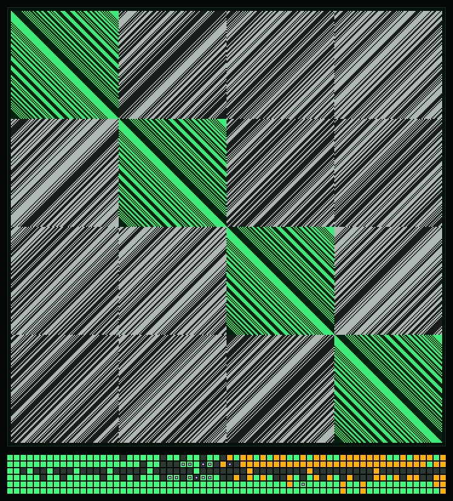

# Hunting Hadamards

A board of exactly verified Goethals-Seidel quadruples, the Hadamard and skew-Hadamard matrices they give, and the orders still open: [hadamards.com](https://hadamards.com).

[](https://hadamards.com/#board) [](https://hadamards.com/#board)



The matrix is the skew-Hadamard matrix of order 356 from entry [n89-eec2e43c042090883c04](https://hadamards.com/entries/n89-eec2e43c042090883c04.html): light is +1, dark is -1, and the four copies of the skew block, on the diagonal, are green. The strip is the board, one column for each odd n from 1 to 131 and one row for each track: green has a verified quadruple, dark is empty, gold is unresolved, and a violet mark is a cell the site marks as a new result.

## What this is

Take a number n and four sequences a, b, c, d of length n with entries +1 and -1. The periodic autocorrelation of a sequence x at shift s is the sum of the products x<sub>i</sub> x<sub>i+s</sub> over i from 0 to n-1, with indices taken modulo n. The four sequences form a **Goethals-Seidel quadruple** when their periodic autocorrelations sum to zero at every nonzero shift.

Let A, B, C, D be the circulant matrices whose first rows are a, b, c, d. The Goethals-Seidel array [[goethals1970skew](https://hadamards.com/references.html#ref-goethals1970skew)] arranges these four blocks, with signs and reversals, into a matrix H of order 4n with entries +1 and -1 such that H Hᵀ = 4n I, where I is the identity matrix: a Hadamard matrix. If the first sequence is skew, meaning a<sub>0</sub> = 1 and a<sub>n-i</sub> = -a<sub>i</sub> for every nonzero i, then also H + Hᵀ = 2I, and H is a skew-Hadamard matrix. A skew sequence needs odd n.

The board covers n up to 300 in six tracks, named by how many of the sequences are symmetric or skew: Williamson, good, best, G-matrices, with a skew block, and any; the front-page grid shows the last two through its hadamard and skew-hadamard columns. At even n only the Williamson and any tracks have cells. [TRACKS.md](TRACKS.md) defines them and the verification tiers, and [the mathematical contract](notes/mathematical-contract.md) states what the verifier checks. The site has a [reference list](https://hadamards.com/references.html).

## Order 356

The board holds eleven inequivalent quadruples with a skew block at n = 89, found between 2026-11-22 and 2026-11-23 and listed on the [n = 89 cell page](https://hadamards.com/cells/n89-skew-sds.html). The array of each is a skew-Hadamard matrix of order 356. That order is the smallest listed as open in [[djokovic2023skew](https://hadamards.com/references.html#ref-djokovic2023skew)], [[araya2024classification](https://hadamards.com/references.html#ref-araya2024classification)] and [[egan2026recent](https://hadamards.com/references.html#ref-egan2026recent)], and it was already listed as not yet known in [[wallis1970configurations](https://hadamards.com/references.html#ref-wallis1970configurations)].

A search of the sources named above on 2026-11-22 found no earlier skew-Hadamard matrix of order 356. That reports the search and is not a claim of priority. The result has not been reviewed.

## Verify an entry

Python 3.11 or later and [uv](https://docs.astral.sh/uv/) are enough for the first two checks. The third replays the bundled censuses and also needs GCC with OpenMP; it took about two and a half minutes on two threads.

```sh
uv sync --locked --group dev
./gs verify quadruples/n89-eec2e43c042090883c04.json   # one entry, from its four rows
./gs verify --quick                                    # every entry, census replays skipped
./gs verify                                            # every entry and every supported census replay
```

Each command prints JSON. For one entry it gives the tracks, the tier, the canonical rows and any baseline flag. No GPU is needed.

## Contribute

Write four rows to a JSON file in the format of an existing entry, run `./gs verify candidate.json`, then `./gs submit candidate.json`, which rejects a candidate equivalent to an entry already on the board and stages a new one. [CONTRIBUTING.md](CONTRIBUTING.md) has the steps, the rules on sources and credit, and what an entry pull request may touch. The submission gate validates an entry pull request with the verifier of the base branch, so an entry cannot change the rules that accept it.

Open cells are listed by `./gs targets`. [AGENTS.md](AGENTS.md) and [research/AUTORESEARCH.md](research/AUTORESEARCH.md) are for automated searches.

## Layout

| Path | Contents |
|---|---|
| `quadruples/`, `certificates/`, `census/` | one JSON entry per file |
| `evidence/` | source archives, run records and census replays that entries cite |
| `baselines/` | sourced status of each cell and order, the contribution registry, `references.bib` |
| `verify/`, `schema/` | the trusted verifier and the entry schemas |
| `tools/`, `gs` | the command line and the importers |
| `site/` | the site generator; `./gs build` writes the site to `docs/`, which is not tracked |
| `formal/` | Lean 4 statements about quadruples; not built by CI |
| `research/` | instructions and starter engines for searches |
| `notes/` | the mathematical contract and [commands and maintenance](notes/board-operations.md) |
| `assets/` | the picture above and the script that draws it |
| `tests/` | pytest suite |

## Authors

Vincent Russo and Trevor Vincent, [vxvware](https://vxvware.com).
